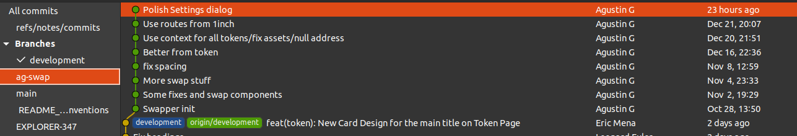
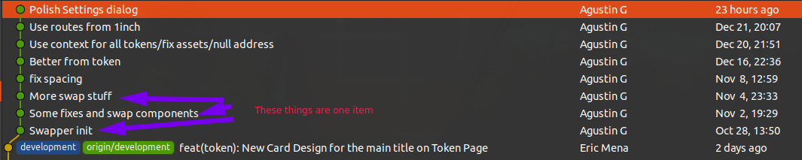
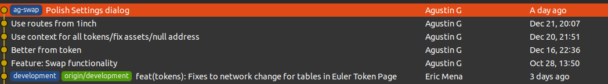

> **This repository is archived.** Source of truth moved.
>
> Destination: https://github.com/tebayoso/eulertools/tree/main/docs/onboarding
>
> Date: 2026-08-12

= Onboarding Documentation
:Author: Euler Tools
:Email: Leonhard Euler <leonard@euler.tools>
:Date: 11 Dec 2021
:Year: 2021
:Revision: 0.0.11/11
:doctype: book
:toc: right
:icons: font
ifdef::env-github[]
:source-highlighter: highglightjs
endif::[]
ifndef::env-github[]
:source-highlighter: coderay
:coderay-style: monokai
:coderay-linenums-mode: table
endif::[]
:sectnums:
:sectanchors:
:empty: {wj}

[cols="2,2"]
|===
|(C) {Year} {Author}
|Revision/Version: {revision}
|===

Configurations and notes on how to work well with the team at Euler Tools.

<<<

:toc:

== Developers

=== Git configuration

Inside of `~/.gitconfig`

.gitconfig
[source%linenums,ini]
----
[commit]
  verbose = yes
  template = ~/.git_template/commit_message <1>
----
<1> See commit template below

If you prefer to have a per-project commit template, you can copy the `commit_message` file to your projects `.git/` directory, and reference it there.

This means that the project configuration file can look like this:

.Project .config
[%linenums,ini]
----
[core]
  repositoryformatversion = 0
  filemode = true
  bare = false
  logallrefupdates = true
[commit]
  verbose = yes <1>
  template = .git/templates/commit_message <2>
----
<1> We simply do not do `commit -m 'some message'`
<2> As exists in the project root

Where the `.git/templates/commit_message` file contains:

ifndef::env-github[]
.Commit Template
[source%linenums,text]
----
include::templates/commit_message[]
----
endif::[]

ifdef::env-github[]
See the commit message template linked below:

link:./templates/commit_message[]
endif::[]

This helps to ensure that the formatting of the commit message is good for multiple tools (not just github web interface) and things like `git bisect` will work (lack of a blank newline can mess that process up), and that acknowledgments are recorded, etc.

=== The language of a commit message

Commits always happen in the "now".
This means that we use present tense verbs, rather than future tense or past tense.

* ✅ Change the behavior
* ❌ Changed the behavior
* ✓ Changes the behavior

The first is current at the point of the commit, and so is correct, while the last example is also correct, but perhaps slightly less so.

=== Git Ignore

The use of the `.gitignore` file is important to the project.
There are four different levels of _ignore files_ to be aware of.

* User (aka "Global")
** This is often located in a file named `~/.gitignore` but can be whatever is specified.
   See the note _Personal Excludes_.
* Project
** This is the `.gitignore` that is in the project root that we know and love.
* Project Subdirectory
** Additionally, we may fine tune our ignores by having one in a subdirectory that only applies to that directory and its subdirectories.
* Personal Project ignores
** This is for personal ignores for a user that has a workflow that generates "cruft" that does not belong in the project.

[NOTE]
.Personal Excludes
====
Patterns which a user wants Git to ignore in all situations (e.g., backup or temporary files generated by the user’s editor of choice) generally go into a file specified by `core.excludesFile` in the user’s `~/.gitconfig`.
====

[TIP]
.Project Personal Excludes
====
Patterns which are specific to a particular repository but which do not need to be shared with other related repositories (e.g., auxiliary files that live inside the repository but are specific to one user’s workflow) should go into the `$GIT_DIR/info/exclude` file.

NOTE: This file will not be tracked by the project.
====

=== Branch Management

There are generally two protected branches.
The first is `main` while the other will be called either `dev`, `develop` or `development`.
Prefer full name, `development`.
But no need to change if it already exists as something other than `development`.

Prefer "rebase and merge" for normal pull requests, rather than "Merge pull request" or "Squash and merge".
This allows for a more linear history, and is easier to work with in many situations.

==== Working a branch

When working from the _development_ branch you will want to create another branch to make your changes from.
You will want to get the latest work done on the `development` branch by doing either:

`git pull origin development`

Or by doing

`git fetch origin ; git reset --hard origin/development`

The latter is what I usually end up doing as I am usually doing review on work based on development branch and I apply the patches and test.
This lets me keep my number of branches locally down to the minimum number of branches.

[TIP]
.Example WorkFlow
====
I usually fetch in parallel with a prune in reality, as this also helps to prune inactive branches from my environment.

```sh
git fetch --all --prune --jobs=4
```

And then I will do `git reset --hard development` to get the development branch as it is on the remote repository.

From there I will apply any code that I am reviewing, or if I am starting work on a new feature or bug fix, then I will do:

```sh
git reset --hard development
```

.Bugfix setup
[source%linenums, sh]
----
$ git checkout -b BugFix_122_Reporting_incorrect_balance
Switched to a new branch 'BugFix_122_Reporting_incorrect_balance'
$ edit file_name_to_correct
# work being done…
$ git add -p                                <1>
diff --git a/faulty_file.js b/faulty_file.js
index bdppa42..27o2378 100644
--- a/fault_file.js
+++ b/fault_file.js
@@ -109,1 +109,1 @@ the `faulty_file.js` file.
# some code
- some_bad_statement
+ some_good_statement_instead
# some other context
(1/1) Stage this hunk [y,n,q,a,d,e,?]? y

$ git commit -v                             <2>
# This opens the editor, reminds us of the changes made so we can give a
# comprehensive summary and message body
----
<1> This allows us to curate the commits. We would not want commits that are not directly relevant to the bug fix.
<2> We just don't use `git commit -m`, it is bad practice, encourages bad commit history.

====

You would then create a new branch based from `development` branch to do the work.

Once the work is ready, self-reviewed, tested, and committed, you push it up for review.
When feedback comes back, you can feel free to make the changes necessary, change the history as you would like to have the commits present, in history.
This is the time when doing a force push on _your_ bug or feature branch is expected.
The history is fluid at this point.

These approaches helps to avoid the nuisance of coming back to the source code history to find out why the code looks the way it does and getting very little information.

=== Long Running Branch Example

Let's take an example from Agustin, who pushes to github occasionally for work from his long running branch to incorporate swap feature from the Euler-Explorer project:



Note that this branch is up to date on the `development` branch.
As that branch moves, Agustin does a `git fetch --all` and then does `git rebase origin/development` which will bring the underlying work in, and will help to ensure that his changes are still working in parallel with other developers work.

Notice the history that seems to be too detailed for the swap information:



Let's get those items in to one history item.

We might do this in the terminal:

[source%linenums, sh]
.Squash historical information to one commit
----
git rebase -i origin/development
----

This opens up my editor, presenting me with this (truncated) _todo_ itemized list:

[source%linenums, sh]
.Vim itemized listing for rebase
----
pick 2f84857 Swapper init
pick 3287785 Some fixes and swap components
pick 7750efc More swap stuff
pick a2c0bf6 fix spacing
pick 59c4845 Better from token
pick dd2836d Use context for all tokens/fix assets/null address
pick 657042b Use routes from 1inch
pick 96e498a Polish Settings dialog

# Rebase ed3cb51..96e498a onto ed3cb51 (8 commands)
#
----

Since we want to squash the fixes and the "more swap stuff" to the "Swapper init", we can squash them, so we change the `pick` to `squash` for those lines.

Because I have not looked specifically at _59c4845 Better from token_ I will leave that as the next commit in the history.

[source%linenums, sh]
.Vim edited itemized listing for rebase
----
pick 2f84857 Swapper init
squash 3287785 Some fixes and swap components
squash 7750efc More swap stuff
squash a2c0bf6 fix spacing
pick 59c4845 Better from token
pick dd2836d Use context for all tokens/fix assets/null address
pick 657042b Use routes from 1inch
pick 96e498a Polish Settings dialog

# Rebase ed3cb51..96e498a onto ed3cb51 (8 commands)
#
----

Saving and closing this list will instruct `git` to get to work, and will present us with a presentation that shows what the changes will be for the new single commit.

[source%linenums, sh]
.Git asks us how to document this commit with details
----
# This is a combination of 4 commits.
# This is the 1st commit message:

Swapper init

# This is the commit message #2:

Some fixes and swap components

# This is the commit message #3:

More swap stuff

# This is the commit message #4:

fix spacing

# Please enter the commit message for your changes. Lines starting
# with '#' will be ignored, and an empty message aborts the commit.
#
# Author:    Agustin G <agustin.gabiola@gmail.com>
# Date:      Thu Oct 28 13:50:44 2021 -0300
#
# interactive rebase in progress; onto ed3cb51
# Last commands done (4 commands done):
#    squash 7750efc More swap stuff
#    squash a2c0bf6 fix spacing
# Next commands to do (4 remaining commands):
#    pick 59c4845 Better from token
#    pick dd2836d Use context for all tokens/fix assets/null address
# You are currently rebasing branch 'ag-swap' on 'ed3cb51'.
#
# Changes to be committed:
#	modified:   src/config.ts
#	modified:   src/pages/dashboard/components/MainCardsRow.tsx
#	new file:   src/pages/swapper/RouteRoad.tsx
#	new file:   src/pages/swapper/TokenSelector.tsx
#	new file:   src/pages/swapper/constants.ts
#	new file:   src/pages/swapper/index.tsx
#	new file:   src/pages/swapper/styles.ts
#	new file:   src/pages/swapper/types.ts
#	modified:   src/routes.tsx
#	modified:   src/slices/entities/yield.ts
#	modified:   src/types/yield.ts
#
# ------------------------ >8 ------------------------
# Do not modify or remove the line above.
# Everything below it will be ignored.
----

I have left off the details of the changes, as it is long, but you can follow along with your own rebase and it does not need to be detailed here.

The important part is to modify the commit message to tell the story of why it exists.

[source%linenums, sh]
.The supplied commit message for the squashed commits
----
Feature: Swap functionality

Configure dashboard
Set routes for Swapper

Add TODO items in source code
----

Once I close the editor, we see that it drops into a detached HEAD and the sha for that commit, and does the work we described:

[source%linenums, sh]
.Git works the rebase out
----
[detached HEAD b4c1f07] Feature: Swap functionality
 Author: Agustin G <agustin.gabiola@gmail.com>
 Date: Thu Oct 28 13:50:44 2021 -0300
 11 files changed, 653 insertions(+), 3 deletions(-)
 create mode 100644 src/pages/swapper/RouteRoad.tsx
 create mode 100644 src/pages/swapper/TokenSelector.tsx
 create mode 100644 src/pages/swapper/constants.ts
 create mode 100644 src/pages/swapper/index.tsx
 create mode 100644 src/pages/swapper/styles.ts
 create mode 100644 src/pages/swapper/types.ts
Successfully rebased and updated refs/heads/ag-swap.
----

And now our history looks like:



We can now do a `git push -f origin ag-swap` to get the work up to the remote repository.
This will allow others to confirm their parallel work works with the proposed changes, will be able to comment on this, and perhaps have conversations about that work.

== Organization

== Documentation

Markdown is used for documentation of the projects as this is then easily converted to various needed or desired formats.
I prefer to use asciidoc{empty}footnote:[https://docs.asciidoctor.org/asciidoc/latest/asciidoc-vs-markdown/] as its focus on publishing for both print and web.
We gain access to admonishments, table of contents, description lists and other things without resorting to HTML, which means that it is easier to read as plain text as well.

[TIP]
.Reference Links in Markdown
====
```markdown
This is a link to the famous [mafalda][1] comic.

[1]: https://www.peruforless.com/blog/cultural-vibes-mafalda-the-comic-strip-character-from-argentina/
```
====

The standards that we want to use while creating our plain text documentation are as follows:

* one sentence per line
* reference style links, see tip _Reference Links in Markdown_
* blank line after heading
* no punctuation at the end of heading
* trailing spaces - Only semantic{empty}footnote:[semantic means "with meaning"] white space belongs in our text files
* no dollar signs used before commands in command line listings if there is no output shown
* ordered lists should use avoid using explicit numbering
* lists should be surrounded by a blank line
* fenced code blocks should be surrounded by a blank line
* HTML should be avoided
* bare URL should be avoided
* EOL (End of Line) should be strictly adhered to in text documents, including markdown, which means that these files should end with an EOL
* images should have alt text given for accessibility

There are others, we will cover some of them in the next section.

=== Style, Linting and Formatting Tooling

==== Github CLI

The Github CLI{empty}footnote:github-cli[https://cli.github.com/] helps by keeping you in the terminal where you are working for git commits, and by providing a way to add the metadata that you also want, such as assignees and reviewers, along with labels.
It also tends to format messages better than the web interface does.
You have probably already seen the difference when looking at the e-mail messages that github sends when a person uses this tool to create issues and pull requests.

Here is one such listing from the terminal:

```plain
$ gh pr view -c 6
Provide and describe editor config file #6
Open • kotp wants to merge 7 commits into main from Doc/editorconfig_setup • +120 -28
Reviewers: agustingabiola (Approved), asilva-ravencloud (Requested),
 ericmenagatti (Requested), jitendrafidel (Requested), mfcattafesta (Requested),
 tebayoso (Requested)
Assignees: kotp
Labels: documentation, enhancement


  Using this we can provide a consistent style throughout the organization,
  while allowing for style conformity for those things that we get from some
  other "upstream".

  More information can be found at editorconfig.org1 https://editorconfig.org/

  No plugin required for quite a few editors and IDE's and platforms. Plugin
  may be required for the developers favorite editor/IDE.


kotp (Contributor) • 9d • Edited

  Approve or changes, but version/revision needs to happen before merged.

kotp (Contributor) • 9d

  Definitely looking for any improvements or what is missing.

agustingabiola approved • 5h • Newest comment

  No body provided


View this pull request on GitHub: https://github.com/eulertools/onboarding/pull/6
```

This still does not pull code conversations, comments made per the _files changed_ tab that we see on the web interface.
And it is still deficient to e-mail patches, due to the potential loss of conversation and information that can be had in the normal workflow of creating features.
But it does help create more consistent pull requests and, for this author, makes keeping up with 400 plus repositories and all the issues and pull requests that go with it, much easier than without.

So together with the web views, and the consistency somewhat enforced by this tool, it is worth looking into.

It does accept templates that we might have for pull requests and issues, though, which can be handy, and it uses your "preferred editor" when creating issues and pull request bodies, which is another benefit (I have yet to see a web based text area that does not _suck_).

===== Github's CLI

.gh command examples
[source%linenums,sh]
----
$ gh issue list

Showing 1 of 1 open issue in eulertools/euler-explorer

#627  Default branch is currently main  enhancement, question  about 2 days ago

$ gh pr list

Showing 4 of 4 open pull requests in eulertools/euler-explorer

#631  feat(global-message): Added Global Message to Home Page  EXPLORER-343
#531  feat: New Explorers Program View                         proposals
#521  New Notifications View and Popper for NavBar             notifications
#484  [DO NOT MERGE] Material UI v5                            ag-material-v5
----

The `gh` cli tool can be installed from GitHub's website.footnote:[https://cli.github.com/], as it is their official tool.


[[heading,editorconfig]]
==== Editor Config.footnote:editorconfig[https://editorconfig.org/]

The organization wide `.editorconfig` information is kept in `onboarding` repository, under the linting directory.

If your editor honors the `.editorconfig` file, place the contents of the following at the root.

ifndef::env-github[]
..editorconfig
[source%linenums,ini]
----
include::linting/editorconfig[]
----
<1> Let the root directive exist higher up (perhaps at `~/.editorconfig`) to allow progressive settings being applied.
<2> We set root to false in the project to allow for more specific settings to be applied here while leaving more general ones out.
endif::[]
ifdef::env-github[]
link:./linting/editorconfig[]
endif::[]

If you have the organization repositories cloned beside each other, you might do `cp ../onboarding/linting/editorconfig .editorconfig` to put it in place.
The `.editorconfig` file in the project can should have `false` set to root, as shown, so that it will "cascade" from settings further up, including personal editor configurations that may be set in the users environment.

More information can be found at the link:https://editorconfig.org/[editorconfig project].

==== Solidity Style Guide

Reference the link:https://docs.soliditylang.org/en/v0.8.10/style-guide.html[Solidity Style Guide] for style concerning Solidity programs

====  Markdown Style Guide

The Markdown Linter project tooling that I use is limited to only a few of the rules, because there are some things that I prefer (such as single sentence per line) that can not be easily enforced, but also contradicts rule md013{empty}footnote:[https://github.com/markdownlint/markdownlint/blob/master/docs/RULES.md#md013---line-length], which is about line length.

Rules for markdown linter `mdl` tooling can be found at link:https://github.com/DavidAnson/markdownlint/blob/main/doc/Rules.md[https://github.com/DavidAnson/markdownlint/blob/main/doc/Rules.md]

..mdlrc
[source%linenums,ini]
----
style '.mdl_style.rb'
----

I have not researched it, but I have heard mention that there may be node tooling to enforce the same things.
This one is pointing to a Ruby oriented syntax file.

..mdl_style.rb
[source%linenums,ini]
----
exclude_rule 'MD013'
exclude_rule 'MD033'
rule 'MD001'
rule 'MD002'
rule 'MD003', :atx => :consistent
rule 'MD004', :style => :dash
rule 'MD005'
rule 'MD006'
rule 'MD007'
rule 'MD009'
rule 'MD010'
rule 'MD011'
rule 'MD012'
rule 'MD014'
rule 'MD022'
rule 'MD023'
rule 'MD024'
rule 'MD025'
rule 'MD028'
rule 'MD032'
rule 'MD034'
rule 'MD035'
rule 'MD036'
rule 'MD037'
rule 'MD038'
rule 'MD039'
rule 'MD040'
rule 'MD041'
----

A quick reference of the rule names can be found in the table of contents of the ``rules.md`{emtpy}footnote:[https://github.com/markdownlint/markdownlint/blob/master/docs/RULES.md] file

== Services

Source code is currently located using link:https://github.com/eulertools[GitHub] as the centralized location.

Tickets are done in link:https://eulertools.atlassian.net[Jira].

